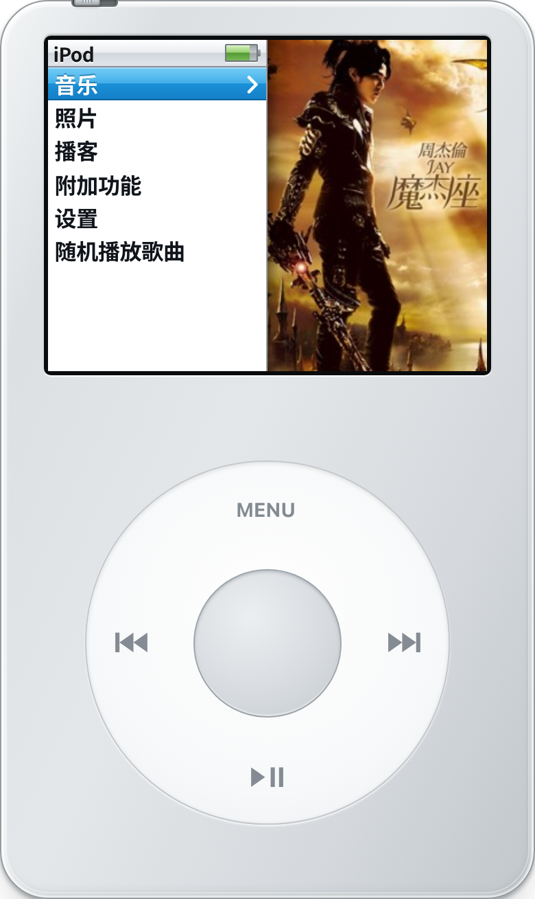
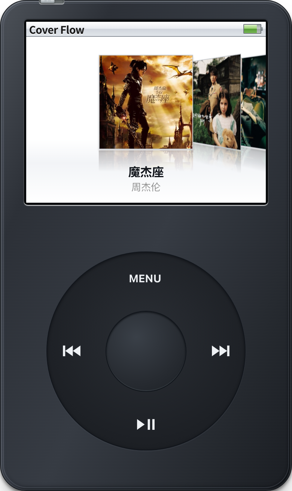
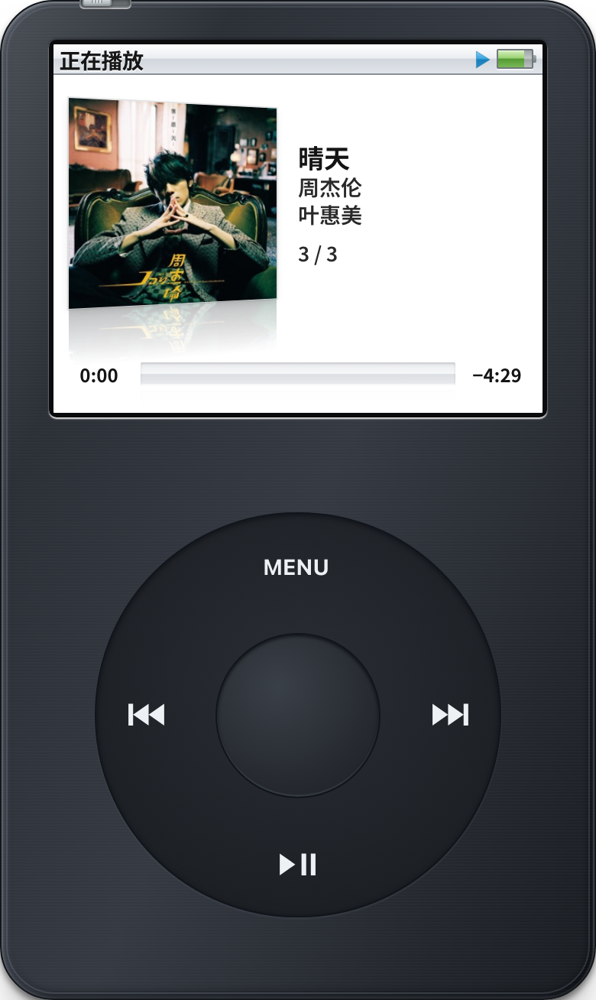
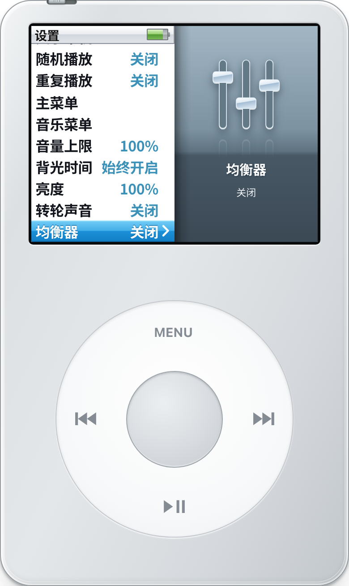

# ReiPod

[English](README.md) · [简体中文](README.zh-CN.md) · [Web Demo (GitHub Pages)](https://a-asuka-a.github.io/ReiPod/) · [Web Mirror (VPS)](https://julyblog.party/ReiPod/) · [iPhone Guide](ios/README.md)

**Your music, a click wheel away.**

ReiPod is a classic-inspired music player for the web and iPhone, built around the 2007 iPod classic 6G interface. Browse your local library, spin through Cover Flow, follow word-synced lyrics, or connect Apple Music, NetEase Cloud Music, and QQ Music—all through a display-only LCD and Click Wheel.

---

## Preview

| Home & Split Preview | Cover Flow | Now Playing | Settings & EQ |
| :---: | :---: | :---: | :---: |
|  |  |  |  |

*Screenshots capture the current web build in Simplified Chinese with bundled demo tracks. Visual proportions follow the 2007 classic 6G layout, with ongoing hardware calibration tracked in [UI_METRICS.md](UI_METRICS.md).*

---

## Features

- **2007 Classic 6G UI & Click Wheel**
  - Silver and Space Black anodized finishes with light, warm, or dark surroundings.
  - Display-only 320×240 logical LCD: split-screen studio previews with chrome icon reflections, glossy Aqua selection bars and status header, Cover Flow stage, Quick Scroll alphabet HUD, HOLD switch locking, and full keyboard/wheel navigation.
- **Local Library & Audio Engine**
  - Client-side audio and metadata import (`music-metadata` ID3/MP4 tags, embedded covers, `compilation` and `sort-as` tags) persisted in IndexedDB.
  - Browse by Artists (with single-album skip), Albums, Compilations, Songs, Genres, Composers, Playlists, and live local search.
  - Built-in **22-preset Web Audio EQ** (3-band biquad filter), **Sound Check** loudness leveling (`DynamicsCompressorNode`), **Shuffle (Off / Songs / Albums)**, **Repeat (Off / One / All)**, and **On-The-Go** playlists.
- **Synchronized Lyrics**
  - YRC grapheme-level soft-edge highlighting with line spring motion; LRC line-by-line sync and embedded lyric import.
  - Hold **Center** on a track and select **歌词** (Lyrics) to jump straight in, or toggle lyrics availability in Settings.
- **Multi-Source Music**
  - Isolated accounts, libraries, and queues across **Local files**, **iPhone system music** (`MediaPlayer`), **Web Apple Music** (`MusicKit`), **NetEase Cloud Music**, and **QQ Music** (via built-in iOS native bridge or HTTPS backend—no browser extensions required).
- **Extras & Classic Wheel Games**
  - **Clocks & Time**: Multi-city World Clocks, **Time in Title** status-bar clock, Stopwatch with lap logs, Alarms (beep or local playlist), Sleep Timer, and Countdown.
  - **Media & Organizer**: Photo albums & configurable Slideshows (slide duration, background music, repeat, shuffle, transitions), Podcasts, Calendar/To-Dos & Contacts (`.ics` / `.vcf` import plus read-only iPhone EventKit/Contacts access), and plain-text **Notes** reader.
  - **Games**: Independent wheel-driven recreations of **iQuiz**, **Klondike**, and **Vortex**.

---

## Controls

| Input | Action |
| :--- | :--- |
| **Wheel / `↑` `↓`** | Scroll menus, Quick Scroll on long lists, or adjust the active control |
| **Center / `Enter`** | Confirm; in Now Playing, cycle Artwork → Seek diamond → Shuffle → Rating → Lyrics |
| **MENU / `Escape`** | Go back; hold **MENU** (or press `Home`) to return to Main Menu |
| **Play/Pause / `Space`** | Play or pause (starts playback directly on highlighted collections) |
| **Previous / Next / `←` `→`** | Skip tracks; hold to seek (space / backspace while typing in Search) |
| **Hold Center** | Open track or photo options |
| **HOLD Switch** | Lock all wheel and button inputs while playback continues |

> On updated iPhone builds, turning the wheel on the default Now Playing screen directly adjusts system volume via `MPVolumeView`.

---

## Music Sources

| Source | Requirements | Current Scope |
| :--- | :--- | :--- |
| **Local files** | Modern browser (MP3 / M4A / WAV) | Full offline import, artwork, tags, playlists, EQ, and Sound Check in browser storage |
| **iPhone system music** | Native iOS shell & Media Library permission | Direct playback and playlist browsing via `MediaPlayer` |
| **Web Apple Music** | Site-owned MusicKit developer token | Catalog/library integration implemented; production DRM & account checks pending |
| **NetEase / QQ Music** | iOS built-in bridge or HTTPS backend (`server/`) | QR login verified on VPS; real-account playback & background checks tracked in [MUSIC_SERVICES.md](MUSIC_SERVICES.md) |

*Web builds on GitHub Pages connect to the maintainer's HTTPS API (`https://julyblog.party/api/music/`). Browser extensions are retired.*

---

## Quick Start & Development

Requires **Node.js 24** for the full workspace (`22.12+` for the web frontend alone).

```sh
# Run the web app locally
npm ci
npm run dev
```

Optional local NetEase/QQ music service:

```sh
npm --prefix server ci --ignore-scripts
npm run build
npm run music:serve
```

Validation & build checks:

```sh
npm test                  # Unit tests (Vitest)
npm run test:music-server # Node backend tests
npm run check:player-core # Verify DOM-free playback core compilation
npm run build             # Type-check & Vite production bundle
node scripts/check-dist.mjs
npm run size              # Verify entry/program/audio size budgets
npm run test:browser      # Playwright E2E suite (requires `npx playwright install chromium`)
```

For native iOS builds and Xcode installation, see [ios/README.md](ios/README.md).

---

## Documentation

| Document | Topic |
| :--- | :--- |
| [USER_GUIDE.md](USER_GUIDE.md) | Detailed controls, imports, playlists, and storage behavior |
| [FIRMWARE_FEATURES.md](FIRMWARE_FEATURES.md) | Classic firmware feature coverage and remaining gaps |
| [MUSIC_SERVICES.md](MUSIC_SERVICES.md) · [MUSIC_BRIDGE.md](MUSIC_BRIDGE.md) | Music backend setup, provider isolation, and iOS native bridge |
| [UI_STANDARDS.md](UI_STANDARDS.md) · [UI_METRICS.md](UI_METRICS.md) | Visual measurement rules and per-state calibration ledger |
| [HARDWARE_RESEARCH.md](HARDWARE_RESEARCH.md) · [REPLICA.md](REPLICA.md) | Hardware references, model boundaries, and provisional decisions |
| [PLAYBACK_INTERACTIONS.md](PLAYBACK_INTERACTIONS.md) | Playback control sequences and state restoration |
| [DEVELOPMENT.md](DEVELOPMENT.md) · [PROJECT_STRUCTURE.md](PROJECT_STRUCTURE.md) · [TASK_LOG.md](TASK_LOG.md) | Architecture layers, directory layout, and active handoff log |

---

## Credits & Legal Notice

- Wheel gesture geometry adapted from [iPod.js](https://github.com/tvillarete/ipod-classic-js); audio metadata powered by [music-metadata](https://github.com/Borewit/music-metadata); UI typography uses a redistributable Noto Sans SC subset.
- Built-in demo tracks (**晴天**, **七里香**, **兰亭序** by Jay Chou) are encoded as 160 kbps / 44.1 kHz AAC-LC M4A files (`17.00 MB` combined) with embedded covers and synchronized YRC/LRC lyrics under owner-confirmed test authorization. Underlying rights belong to their respective owners; see [THIRD_PARTY_NOTICES.md](THIRD_PARTY_NOTICES.md) and in-app credits.
- ReiPod is an independent project and is not affiliated with Apple, NetEase, or Tencent.
