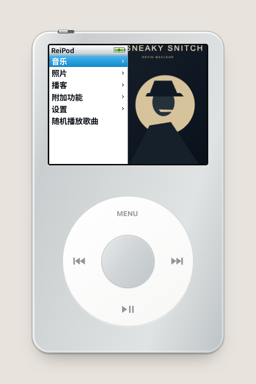
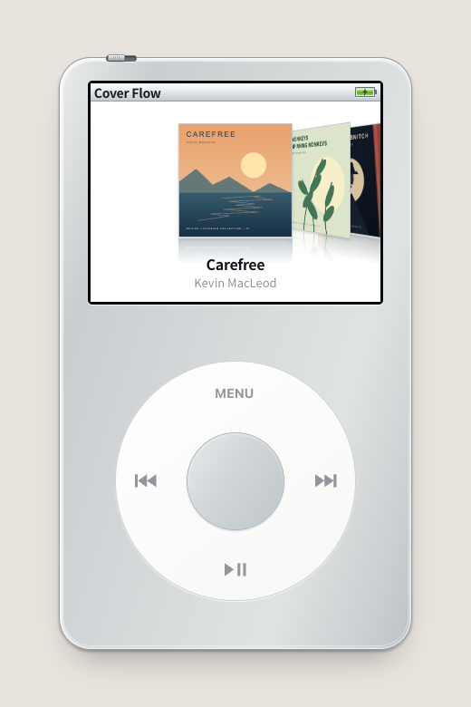
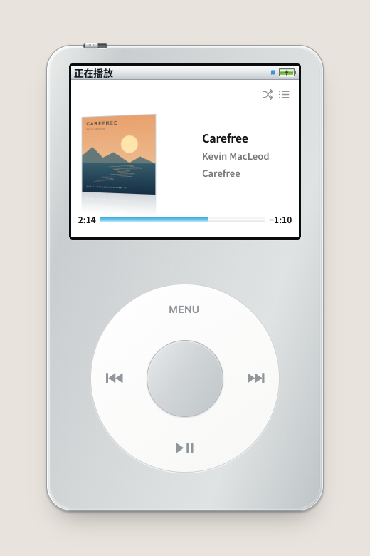

# ReiPod

[English](README.md) · [简体中文](README.zh-CN.md)

**Your music, a click wheel away.**

A classic-style music player for the web and iPhone. Browse album artwork with Cover Flow, build a local library, follow lyrics, or connect a music service—all through the wheel and buttons.

[Try the web player](https://a-asuka-a.github.io/ReiPod/) · [Install on iPhone](ios/README.md) · [Music service setup](MUSIC_SERVICES.md)

## A look inside

|                                                    Library & menus                                                     |                                           Cover Flow                                            |                                                           Now Playing                                                            |
| :--------------------------------------------------------------------------------------------------------------------: | :---------------------------------------------------------------------------------------------: | :------------------------------------------------------------------------------------------------------------------------------: |
|  |  |  |

Screenshots show the current web build with included demo music. The interface currently uses Simplified Chinese; these two README versions do not change the app's language. UI calibration against the 2007 iPod classic 6G is ongoing.

## What you can do

- **Bring your own music.** Import audio with metadata and embedded artwork. Browse artists, albums, songs and genres; search, favorite tracks and make browser-local playlists.
- **Browse with the wheel.** Cover Flow, contextual menu previews, remembered selections, HOLD locking and keyboard controls keep navigation inside the player.
- **Read lyrics while listening.** Import LRC or embedded lyrics, or fetch lyrics through the optional NetEase/QQ backend. Hold Center and confirm **歌词** (Lyrics) to open them quickly; turn the feature on or off in Settings.
- **Choose your music source.** Use the iPhone's system music library, configure web Apple Music, or self-host NetEase Cloud Music and QQ Music. Account sessions and libraries stay separate; catalog VIP/purchase labels and playback errors explain restrictions.
- **Make it yours.** Silver or black finish, light or dark surroundings, shuffle/repeat, ratings, backlight and wheel sounds.
- **Keep more in your pocket.** Local photo albums and slideshows, podcast imports with resume positions, and a text reader with saved reading progress.

## Music sources

| Source              | What it needs                                                            | Current scope                                                                                                  |
| ------------------- | ------------------------------------------------------------------------ | -------------------------------------------------------------------------------------------------------------- |
| Local files         | A supported browser; no account or backend                               | Imports, artwork, playlists and playback; data stays in that browser                                           |
| iPhone system music | The native shell, iOS permission and playable music in Apple's Music app | Library, existing playlists and playback through MediaPlayer; no web MusicKit developer token                  |
| Web Apple Music     | Site-owned MusicKit developer configuration and listener authorization   | Library/catalog integration implemented; production credentials and real-account DRM validation remain pending |
| NetEase Cloud Music | Optional Node.js backend and QR login                                    | Real-account login, playlists, playback controls and lyrics verified locally                                   |
| QQ Music            | The same backend; QQ or WeChat QR login                                  | Implemented and covered by mock tests; real-account login/playback verification remains pending                |

**GitHub Pages hosts the static player.** NetEase/QQ require a separately reachable backend; pushing this repository does not deploy that service. Their integrations use community APIs, and playback remains subject to account access, region and platform availability. No alternative-source unlocking is provided. See [setup and verification limits](MUSIC_SERVICES.md).

## Start listening

Open the [web player](https://a-asuka-a.github.io/ReiPod/) and play an included demo track, or use **音乐 → 导入音乐** (Music → Import Music) to choose your files. MP3, AAC/M4A and PCM WAV are suggested; decoding depends on the browser.

The LCD is display-only. Use the wheel and buttons:

| Control               | Action                                                                                   |
| --------------------- | ---------------------------------------------------------------------------------------- |
| Wheel / ↑ ↓           | Select a menu item; adjust the current playback control                                  |
| Center / Enter        | Confirm; in Now Playing, cycle artwork → seek → shuffle → rating → lyrics when available |
| MENU / Escape         | Go back; hold MENU to return home (Home on keyboard)                                     |
| Play/Pause / Space    | Play or pause                                                                            |
| Previous / Next / ← → | Change track; hold to seek                                                               |
| Hold Center           | Open song options; Lyrics is first when available or fetchable                           |
| HOLD switch           | Lock input while playback continues                                                      |

On iPhone, use the side buttons for system volume. Lyrics can stay open across menu visits and queue skips; temporary seek/shuffle/rating controls reset. See the [playback state rules](PLAYBACK_INTERACTIONS.md) and [full user guide](USER_GUIDE.md).

Local imports, settings and playlists are stored in the browser. Clearing site data or storage eviction can remove them, so keep your original files. Web playback does not guarantee background or lock-screen behavior; the native system-music route uses iOS playback.

## Run locally

Use **Node.js 24** for the full setup (the web app alone supports 22.12+).

```sh
npm ci
npm run dev
```

For the optional NetEase/QQ backend:

```sh
npm --prefix server ci --ignore-scripts
npm run build
npm run music:serve
```

Open `http://127.0.0.1:3210/`, then **设置 → 音乐服务** (Settings → Music Services). The backend listens on localhost by default. Public web/iPhone use needs an HTTPS backend and explicit allowed origins; configuration is documented in [MUSIC_SERVICES.md](MUSIC_SERVICES.md).

For the iPhone app, follow the [Mac/Xcode installation guide](ios/README.md). A free Personal Team can sign for personal-device testing; it is not an App Store release.

## Development

Built with React, TypeScript and Vite. A thin WKWebView/MediaPlayer shell reuses the web interface on iPhone; the optional music backend runs separately.

```sh
npm test
npm run test:music-server
npm run build
node scripts/check-dist.mjs
npm run size
```

Browser regression tests:

```sh
npx playwright install chromium
npm run test:browser
```

Pushes to `main` build and deploy the static site with GitHub Actions. UI work uses physical-device evidence first; existing CSS values and passing tests are not proof of hardware accuracy.

| Documentation                                                           | Purpose                                                               |
| ----------------------------------------------------------------------- | --------------------------------------------------------------------- |
| [User guide](USER_GUIDE.md)                                             | Detailed browsing, controls, imports and storage behavior             |
| [Music services](MUSIC_SERVICES.md)                                     | Configuration, credentials, backend deployment and verification scope |
| [iPhone app](ios/README.md)                                             | Native build, installation and device checks                          |
| [UI standards](UI_STANDARDS.md)                                         | Evidence levels, measurements and visual acceptance                   |
| [Hardware research](HARDWARE_RESEARCH.md) · [Replica notes](REPLICA.md) | Sources, model/version boundaries and provisional values              |
| [Playback interactions](PLAYBACK_INTERACTIONS.md)                       | Center-button sequence, lyrics shortcut and state restoration         |
| [Development instructions](AGENTS.md)                                   | Repository conventions and validation                                 |

## Credits

Click-wheel geometry is adapted from [iPod.js](https://github.com/tvillarete/ipod-classic-js); audio metadata uses [music-metadata](https://github.com/Borewit/music-metadata). Fonts use a redistributable Noto Sans SC subset. Included demo tracks **Carefree**, **Monkeys Spinning Monkeys** and **Sneaky Snitch** are by Kevin MacLeod under CC BY 4.0; covers are original ReiPod artwork. See [third-party notices](THIRD_PARTY_NOTICES.md) and in-app credits for attribution and license details.

ReiPod is an independent project, not affiliated with Apple, NetEase or Tencent. Names and trademarks belong to their respective owners.
