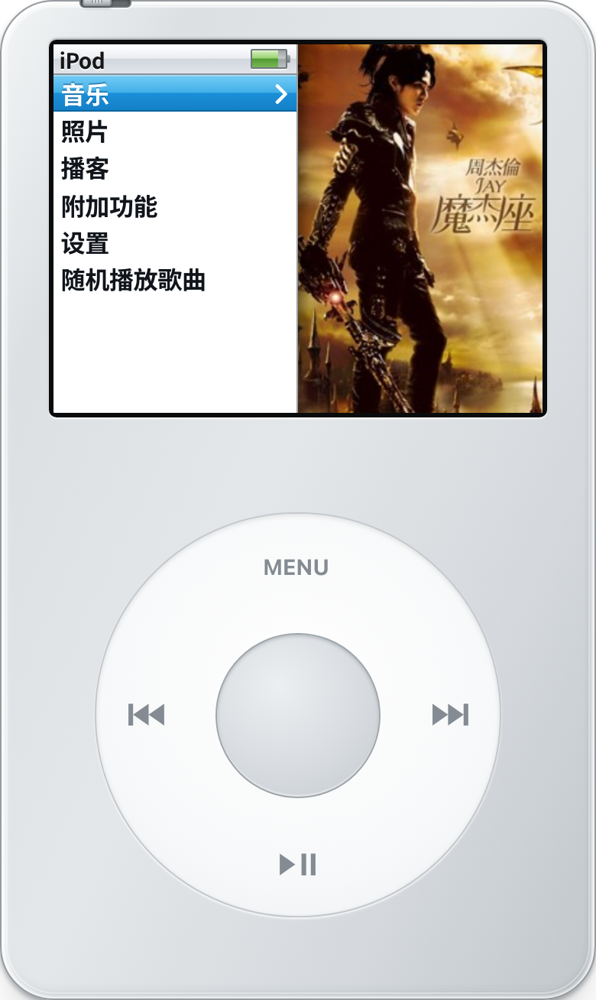
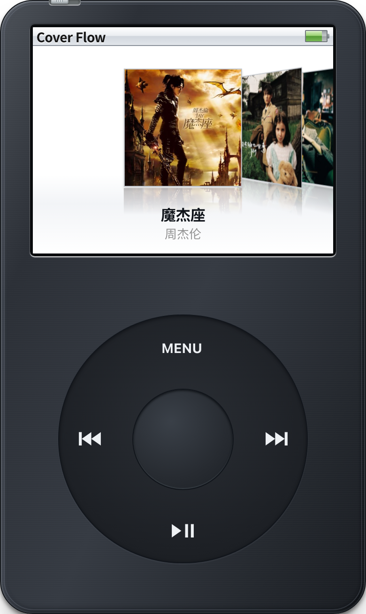
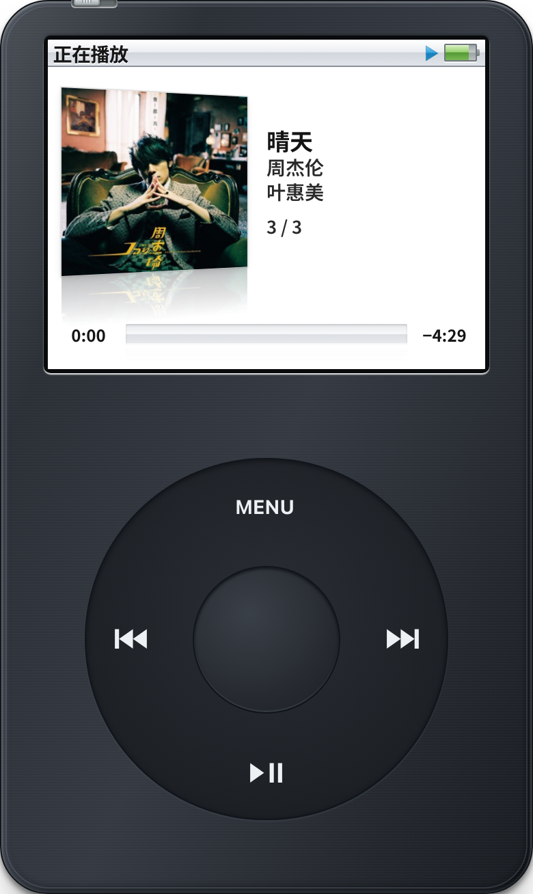
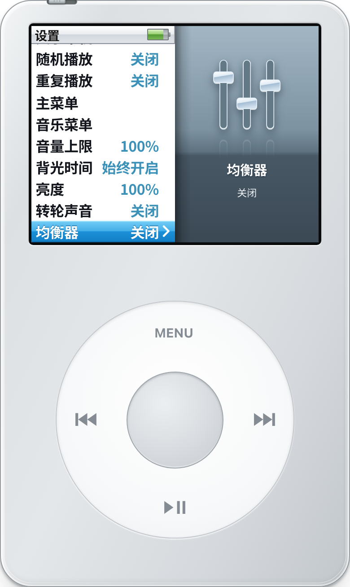

# ReiPod

[English](README.md) · [简体中文](README.zh-CN.md) · [网页版 (GitHub Pages)](https://a-asuka-a.github.io/ReiPod/) · [镜像站 (VPS)](https://julyblog.party/ReiPod/) · [iPhone 安装指南](ios/README.md)

**转动转轮，听见你的音乐。**

ReiPod 是一个面向网页与 iPhone 的经典风格音乐播放器，以 2007 年 **iPod classic 6G** 交互体验为设计基线。仅通过转轮与按键即可管理本地音乐资料库、浏览 Cover Flow、跟随逐字歌词，或连接 Apple Music、网易云音乐与 QQ 音乐。

---

## 界面预览

| 主菜单与分屏预览 | Cover Flow | 正在播放 | 设置与均衡器 |
| :---: | :---: | :---: | :---: |
|  |  |  |  |

*以上截图均采自当前网页构建版本（使用内置试听曲目，应用内语言目前为简体中文）。整体界面参照 2007 iPod classic 6G 视觉规范，实机逐状态校准持续记录于 [UI_METRICS.md](UI_METRICS.md)。*

---

## 核心特性

- **2007 Classic 6G 视觉与纯转轮操作**
  - 提供银色、黑色阳极氧化金属外观，以及浅色、暖色、深色背景环境。
  - 320×240 逻辑网格 LCD 仅作显示：分屏工作室地平线预览与 3D 图标倒影、Aqua 光泽状态栏与高亮选中条、Cover Flow 封面墙、长列表快转字母定位（Quick Scroll）、HOLD 锁定与全套键盘映射。
- **本地音乐资料库与音频处理**
  - 浏览器本地导入音频（`music-metadata` 解析 ID3/MP4 标签、内嵌封面、`compilation` 与排序标签），离线持久保存于 IndexedDB。
  - 支持按艺人（单专辑自动直达歌曲）、专辑、合辑、歌曲、风格、作曲者、歌单浏览，以及实时本地搜索。
  - 内置 **22 组经典 Web Audio EQ 预设**（3 段滤波）、**音量平衡 / Sound Check**（`DynamicsCompressorNode`）、**随机播放（关闭 / 歌曲 / 专辑）**、**重复播放（关闭 / 单曲 / 全部）** 与 **On-The-Go** 工作列表。
- **高帧率同步歌词**
  - YRC 支持逐字柔边高亮与弹簧行运动；LRC 支持逐行同步并可自动解析内嵌歌词。
  - 长按**中心键**确认首项 **歌词** 即可直达，也可在设置中随时开关。
- **多音源与隔离架构**
  - **本地文件**、**iPhone 系统音乐**（`MediaPlayer`）、**网页 Apple Music**（`MusicKit`）、**网易云音乐** 与 **QQ 音乐**（通过 iOS 内置原生桥或 HTTPS 后端连接，已废除浏览器扩展），各来源账号会话与队列完全隔离。
- **经典附加功能与小游戏**
  - **时钟与时间**：多城市世界时钟、**标题栏实时时钟**、带分段统计的秒表、闹钟（蜂鸣或本地歌单唤醒）、睡眠定时与倒计时。
  - **媒体与个人管理**：照片相册与可配置幻灯片（每张停留、背景音乐、重复、随机、过渡效果）、播客浏览、日历/待办与通讯录（支持 `.ics` / `.vcf` 导入及 iPhone 只读系统同步）、纯文本阅读器。
  - **经典游戏**：独立重现 **iQuiz**、**Klondike** 与 **Vortex** 三款转轮游戏。

---

## 转轮与按键控制

| 操作 | 功能说明 |
| :--- | :--- |
| **转轮 / `↑` `↓`** | 上下浏览菜单、快转触发字母索引，或调节当前进度 / 音量 / 评分 |
| **中心键 / `Enter`** | 确认进入；播放页按 封面 → 进度菱形 → 随机 → 评分 → 歌词 顺序切换 |
| **MENU / `Escape`** | 返回上一级；长按 **MENU**（或按 `Home`）回到主菜单 |
| **播放暂停 / `Space`** | 播放或暂停；选中分类时可直接起播 |
| **上一首 / 下一首 / `←` `→`** | 切换曲目；长按快进 / 快退（搜索输入时作为空格 / 退格） |
| **长按中心键** | 打开当前曲目或照片选项面板 |
| **HOLD 开关** | 锁定转轮与按键防误触，音乐继续播放 |

> 在新版 iPhone 容器中，位于默认“正在播放”页面时转动转轮可直接通过 `MPVolumeView` 调节系统音量。

---

## 音乐来源对照

| 音源 | 所需条件 | 当前支持范围 |
| :--- | :--- | :--- |
| **本地文件** | 现代浏览器（推荐 MP3 / M4A / WAV） | 完整支持标签/封面解析、本地歌单、EQ 与音量平衡 |
| **iPhone 系统音乐** | 原生 iOS 容器及“媒体资料库”授权 | 通过系统 `MediaPlayer` 浏览资料库/歌单并播放 |
| **网页 Apple Music** | 站点配置的 MusicKit 开发者密钥 | 已接入目录与资料库接口；生产环境密钥与真机 DRM 验证待完成 |
| **网易云 / QQ 音乐** | iOS 内置桥或 HTTPS 后端（`server/`） | 已在 VPS 验证二维码链路；真实账号登录与后台播放见 [MUSIC_SERVICES.md](MUSIC_SERVICES.md) |

*GitHub Pages 与 VPS 网页均已对接维护者 HTTPS API（`https://julyblog.party/api/music/`），不再依赖第三方浏览器扩展。*

---

## 本地运行与开发

完整工作区推荐使用 **Node.js 24**（仅运行网页前端可使用 22.12+）。

```sh
# 启动网页开发环境
npm ci
npm run dev
```

如需启用本地自托管网易云 / QQ 音乐后端：

```sh
npm --prefix server ci --ignore-scripts
npm run build
npm run music:serve
```

常用测试与构建检查命令：

```sh
npm test                  # 单元测试（Vitest）
npm run test:music-server # 音乐服务节点测试
npm run check:player-core # 校验无 DOM 播放核心纯 TS 编译
npm run build             # 类型检查与 Vite 生产构建
node scripts/check-dist.mjs
npm run size              # 校核入口、程序代码与内置音频体积预算
npm run test:browser      # Playwright 浏览器回归（需先 npx playwright install chromium）
```

iPhone 真机签名与 Xcode 构建流程请参阅 [ios/README.md](ios/README.md)。

---

## 文档索引

| 文档 | 说明 |
| :--- | :--- |
| [USER_GUIDE.md](USER_GUIDE.md) | 详细操作指引、导入格式与本地存储说明（英文） |
| [FIRMWARE_FEATURES.md](FIRMWARE_FEATURES.md) | Classic 原固件功能覆盖对照与待补项 |
| [MUSIC_SERVICES.md](MUSIC_SERVICES.md) · [MUSIC_BRIDGE.md](MUSIC_BRIDGE.md) | 音乐后端配置、服务隔离与 iOS 原生网络桥 |
| [UI_STANDARDS.md](UI_STANDARDS.md) · [UI_METRICS.md](UI_METRICS.md) | UI 证据分级、测量方法与逐状态指标台账 |
| [HARDWARE_RESEARCH.md](HARDWARE_RESEARCH.md) · [REPLICA.md](REPLICA.md) | 原机参考资料、版本边界与当前实现记录 |
| [PLAYBACK_INTERACTIONS.md](PLAYBACK_INTERACTIONS.md) | 播放状态流转、中心键顺序与歌词快捷规范 |
| [DEVELOPMENT.md](DEVELOPMENT.md) · [PROJECT_STRUCTURE.md](PROJECT_STRUCTURE.md) · [TASK_LOG.md](TASK_LOG.md) | 四层架构约定、目录分工与持续交接日志 |

---

## 致谢与声明

- 转轮几何交互参考自 [iPod.js](https://github.com/tvillarete/ipod-classic-js)，音频元数据解析使用 [music-metadata](https://github.com/Borewit/music-metadata)，UI 字体采用可再分发的 Noto Sans SC 子集。
- 内置试听曲目为周杰伦 **晴天**、**七里香**、**兰亭序**（160 kbps / 44.1 kHz AAC-LC 立体声 M4A，合计 `17.00 MB`，含内嵌封面及同步 YRC/LRC 歌词），仅依据项目所有者确认的授权用于测试演示，底层版权归原权利人所有；详细归属见 [THIRD_PARTY_NOTICES.md](THIRD_PARTY_NOTICES.md) 及应用内版权页。
- ReiPod 为独立开源项目，与 Apple、网易或腾讯无隶属关系，相关商标归各自权利人所有。
